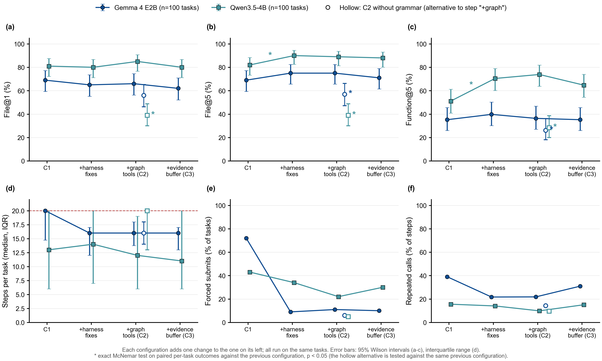
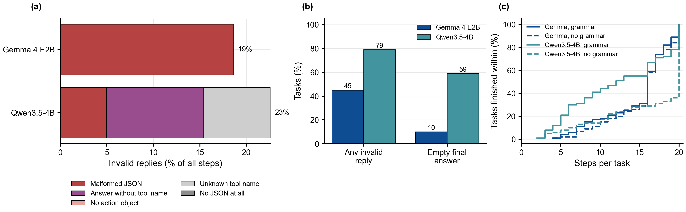
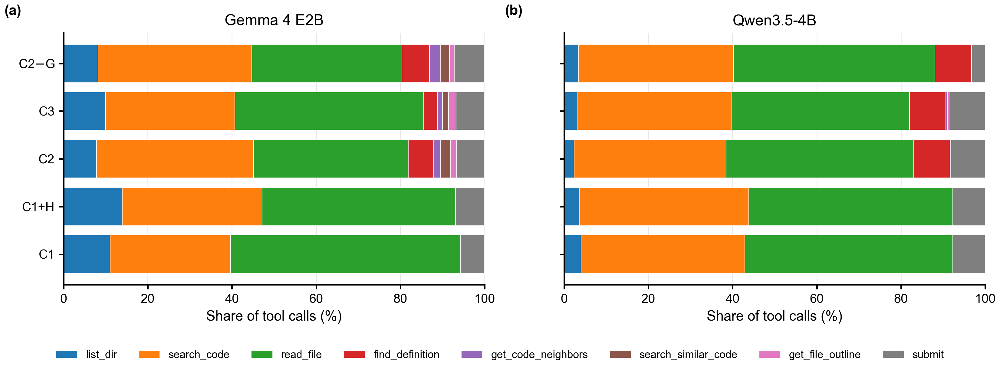
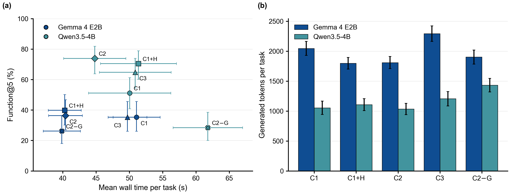
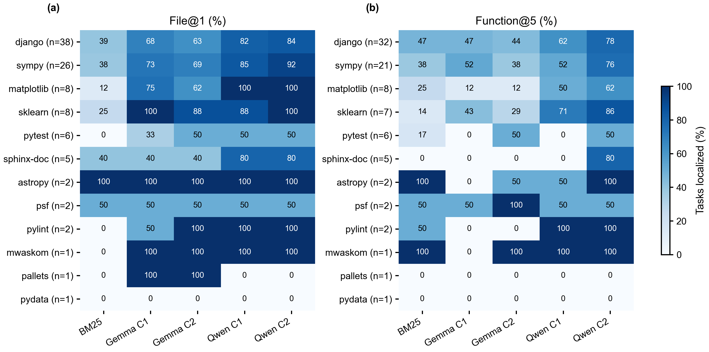
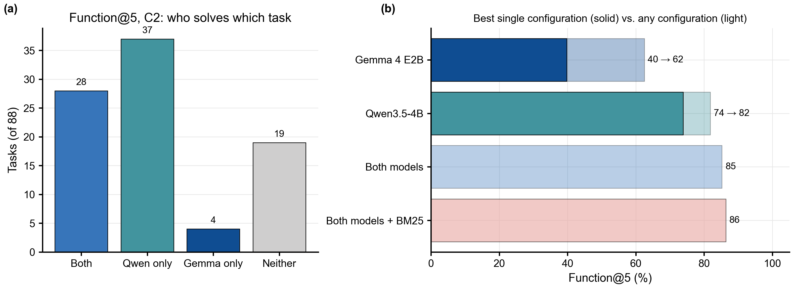
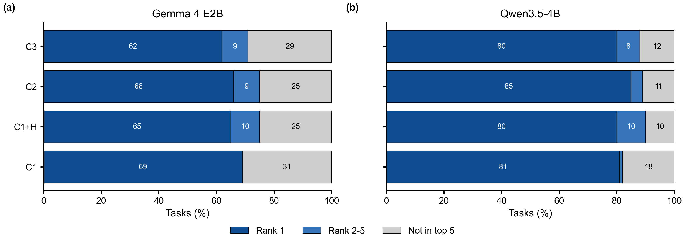
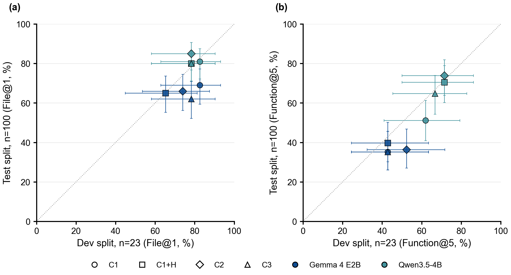
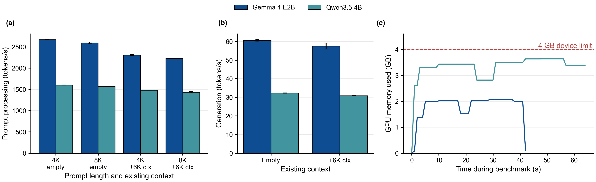
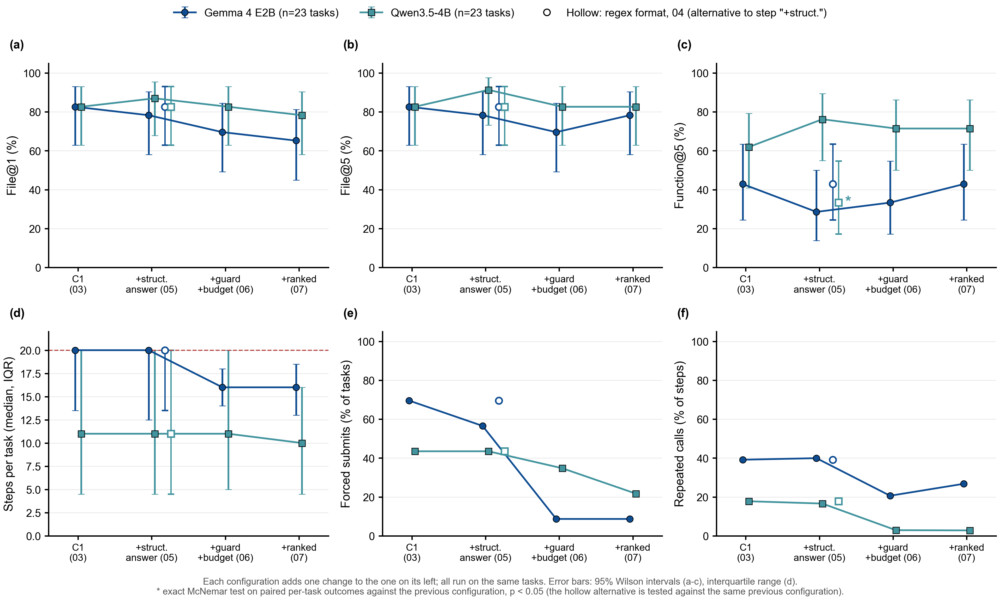

# slm-bug-localizer

**Training-free bug localization with small language models (≤ 4B parameters), running fully offline on a 4 GB laptop GPU.**

Given a GitHub issue and the repository, the agent finds the files and functions that need to change. We use off-the-shelf models as released and change only the *scaffolding* around them, then measure which parts of a typical agent design actually help small models.

📄 **Paper (PDF): [Grammar Matters More Than Graphs: Training-Free Bug Localization with Sub-4B Language Models on a 4 GB Consumer GPU](paper/main.pdf)**: 26 pages with every figure inline; LaTeX source in [`paper/`](paper/).

| | |
|---|---|
| Models | Gemma 4 E2B (QAT Q4_0) and Qwen3.5-4B (Q4_K_M), llama.cpp, non-thinking mode, greedy decoding |
| Hardware | Laptop with an NVIDIA RTX 2050 (4 GB VRAM), 14 GB RAM; no server, no API |
| Benchmark | SWE-bench Lite: dev split (23 tasks) for tuning, a fixed 100-task test subset for evaluation |
| Scale | 1,000 test episodes (5 configurations × 2 models × 100 tasks), 13.3 GPU-hours, plus 9 dev experiments |

## Key findings

1. **Grammar-constrained decoding is the most important component.** Without it, Qwen3.5-4B's File@1 falls from **85% to 39%** (46 tasks lost, none gained; exact McNemar p ≈ 3·10⁻¹⁴). Free-text replies are invalid in about 1 step in 5. Qwen most often writes a complete answer but leaves out `"tool": "submit"`, so 59% of its episodes end with an empty answer.
2. **The form of the answer matters as much as the search.** Structured `{file, name}` answers, a repeated-call guard, turn-budget hints and ranked lists raise Qwen's Function@5 from **51% to 70%** (17 tasks gained, 0 lost, p < 10⁻⁴). In contrast, forcing the `path.py::Name` format with a regex *halved* Qwen's accuracy on the dev split: the grammar made the output well-formed but corrupted correct answers.
3. **Code-graph tools and an Evidence Buffer give no significant gain.** The models send under 12% of their calls to the graph tools, almost all of them `find_definition`, and keep grepping and reading files. The Evidence Buffer makes the models generate 17–27% more tokens and lowers accuracy slightly.
4. **The best system (Qwen3.5-4B, C2) localizes the right file for 85% of tasks and the right function for 74%, at about 45 s per task,** against 33% and 36% for BM25 retrieval. Gemma 4 E2B's behavior improves (forced answers fall from 72% to 9% of tasks), but its accuracy does not, and at function level it only ties BM25.
5. **There is headroom in the configurations.** At least one configuration solves 85% of tasks, while the best single configuration solves 74%. This points to ensembling or self-consistency as a next step.

## Main results (test subset, 100 tasks)

Percentages; Function@5 is measured over the 88 tasks whose gold patch changes an existing function. 95% Wilson intervals are in the [paper](paper/main.pdf), Table 3.

Best value per column in bold.

| ID | Configuration | Gemma File@1 | Gemma File@5 | Gemma Func@5 | Qwen File@1 | Qwen File@5 | Qwen Func@5 | Median s/task (G / Q) |
|---|---|---|---|---|---|---|---|---|
| C0 | BM25 retrieval, no LLM | 33 | 64 | 36 | 33 | 64 | 36 | 2 (CPU) |
| C1 | ReAct agent + file tools | **69** | 69 | 35 | 81 | 82 | 51 | 55 / 41 |
| C1+H | + harness fixes (structured answers, repeat guard, budget hints, ranked lists) | 65 | **75** | **40** | 80 | **90** | 70 | 42 / 48 |
| C2 | + code-graph tools (*full system*) | 66 | **75** | 36 | **85** | 89 | **74** | 43 / 40 |
| C3 | + Evidence Buffer | 62 | 71 | 35 | 80 | 88 | 65 | 52 / 46 |
| C2−G | C2 **without** grammar-constrained decoding | 56 | 57 | 26 | 39 | 39 | 28 | 41 / 64 |

**File@k** means every gold file is in the top-k predictions; **Function@k** means every gold function is in the top-k.



*Test-set ablation ladder. Each step adds one component; hollow markers show C2 without grammar. (a–c) accuracy with 95% Wilson intervals; (d) steps per task; (e) episodes that ended only because the last turn forced `submit`; (f) share of steps that repeat an earlier call. \* marks an exact McNemar p < 0.05 against the previous configuration.*

## What goes wrong without the grammar



*(a) Invalid replies as a share of all steps, by type. Gemma's failures are malformed JSON. Qwen's are mostly well-formed final answers without `"tool": "submit"`, or tool names that don't exist. (b) Episodes with at least one invalid reply, and episodes with an empty final answer. (c) Episode length with the grammar (solid) and without it (dashed).*

## Small models barely use graph tools



*Share of tool calls per configuration. From C2 on, graph tools (red, purple, brown, pink) are available but get about one call in ten. In C2, Qwen calls `get_code_neighbors` and `get_file_outline` once each and never calls `search_similar_code`. Having a tool available is not the same as using it.*

## Cost and accuracy



*(a) Function@5 against mean wall time per task. (b) Generated tokens per task. On a 4 GB GPU, generating tokens takes most of the time, so the components that make the model write more cost the most: the Evidence Buffer, and free-text replies without the grammar.*

## Where the models succeed



*Accuracy per repository. The agents beat BM25 at file level almost everywhere. At function level, Gemma stays close to BM25 on django and sympy, the two largest repositories in the subset.*



*(a) Which model solves which task in C2 (Function@5, 88 tasks): almost every task Gemma solves, Qwen solves too. (b) Best single configuration compared with the tasks solved by at least one configuration.*

<details>
<summary>More figures: rank of the correct file, dev vs. test, hardware benchmark, dev-split ladder</summary>



*Rank of the first correct file in the submitted list. With ranked lists required, both models submit exactly three files. Their second and third guesses add 4–10 points.*



*Dev split (23 tasks) against test split (100 tasks) for the same configurations. The dev split predicts Qwen well and overestimates Gemma.*



*`llama-bench` on the RTX 2050. Gemma 4 E2B generates about 58 tokens/s using 2.1 GB; Qwen3.5-4B about 31 tokens/s using up to 3.7 GB.*



*Dev-split ladder, including the regex-format experiment (hollow marker): forcing `path.py::Name` cut Qwen's Function@5 from 62% to 33%, the only significant change on the dev split.*

</details>

## The agent harness

One ReAct-style loop serves both models through `llama-server`. Each turn, the model returns one JSON object, `{"thought": ..., "action": {"tool": ..., args}}`. Episodes last 20 turns, and the last turn allows only `submit`.

| Component | Configuration | What it does |
|---|---|---|
| File tools | C1 | `list_dir`, `search_code` (ripgrep), `read_file` (line ranges); each output is capped at about 1K tokens |
| Grammar-constrained decoding | all except C2−G | The reply's JSON schema is compiled into a llama.cpp grammar, so every turn is a valid tool call. Requests go through `/apply-template` + `/completion`, because the chat endpoint applied the grammar only after a thinking block |
| Structured answers | C1+H | Each function is submitted as `{"file": ..., "name": ...}`, not as a free-form string |
| Repeated-call guard | C1+H | An exact repeat of an earlier call is not executed; the model is told to act differently or submit |
| Budget hints | C1+H | Each observation ends with `[Turn i of 20]`; in the last 5 turns the model is told to submit once it has a candidate |
| Ranked lists | C1+H | `submit` requires 3–5 files and 3–10 functions, best first |
| Graph tools | C2 | `find_definition`, `get_code_neighbors` (name-matched call graph), `search_similar_code` (BM25 over function bodies), `get_file_outline`, built on an `ast` index |
| Evidence Buffer | C3 | Each reply carries a short `evidence` fact; collected facts survive when old tool outputs are hidden |

## All experiments

Every experiment has its own folder in [`results/`](results/) with its configuration, per-task results, metrics and figures (PDF and PNG). The dev experiments also have notes (`NOTES.md`).

| # | Experiment | Split | Main finding |
|---|---|---|---|
| 01 | [Hardware benchmark](results/2026-10-25_01_hw-bench/) | – | Both models fit on 4 GB; generation runs at about 58 (Gemma) and 31 (Qwen) tokens/s |
| 02 | [End-to-end smoke test](results/2026-10-25_02_e2e-smoke/) | 1 task | Pipeline works; switching to `/completion` gave 0 invalid replies; history compression costs the KV cache |
| 03 | [C1 baseline](results/2026-10-25_03_c1-dev/) | dev | 83% File@1 for both models; naming the function is the bottleneck; Gemma loops (70% forced answers) |
| 04 | [Regex-forced function names](results/2026-10-25_04_fmt-dev/) | dev | **Negative:** malformed names drop to 0%, but Qwen's Function@5 falls from 62% to 33% (p = 0.031) |
| 05 | [Structured answers](results/2026-10-25_05_struct-dev/) | dev | Qwen Function@5 rises to 76%; Gemma falls to 29%: the effect depends on the model |
| 06 | [Repeat guard + budget hints](results/2026-10-25_06_guard-dev/) | dev | Gemma's forced answers drop from 57% to 9%, with no accuracy change: fixing the behavior did not fix accuracy |
| 07 | [Ranked lists](results/2026-10-25_07_ranked-dev/) | dev | Both models submit exactly 3 candidates; Gemma's later guesses add hits |
| 08 | [Dev ablation](results/2026-10-25_08_dev-ablation/) | dev | Paired tests across 03 → 07; only experiment 04 is significant |
| 09 | [C0 BM25](results/2026-10-25_09_c0-dev/) | dev | 35% File@1; at function level BM25 ties Gemma (43%) |
| 10 | [C2 graph tools](results/2026-10-25_10_c2-dev/) | dev | Gemma's best dev result (Function@5 52%), not significant; graph tools get under 10% of calls |
| 11 | [C3 Evidence Buffer](results/2026-10-25_11_c3-dev/) | dev | **Negative:** no gain; time per task rises 43–52% |
| 12 | [C3 without grammar](results/2026-10-26_12_c4g-dev/) | dev | Invalid replies appear in 39% of Gemma's episodes; Qwen's File@1 falls to 57% |
| 13 | [C0 BM25](results/2026-10-26_13_c0-test/) | test | 33% File@1, 64% File@5, 36% Function@5 |
| 15 | [C1](results/2026-10-26_15_c1-test/) | test | Gemma hits the step limit in 72% of episodes; 44% of Qwen's tasks have malformed function names |
| 16 | [C1+H](results/2026-10-27_16_h07-test/) | test | Qwen Function@5 rises from 51% to 70% (17 gained, 0 lost) |
| 14 | [C2 (full system)](results/2026-10-26_14_c2-test/) | test | Qwen: 85% File@1, 74% Function@5; Gemma: 66% and 36% |
| 17 | [C3](results/2026-11-09_17_c3-test/) | test | Slightly lower than C2 on every metric, with more tokens generated |
| 18 | [C2 without grammar](results/2026-11-09_18_c4g-test/) | test | Qwen's File@1 drops from 85% to 39%; 59% of its answers are empty |
| 19 | [Test ablation](results/2026-11-10_19_test-ablation/) | test | Ladder figure and paired McNemar tests (`stats.json`) |

## Hypotheses

| Hypothesis | Outcome |
|---|---|
| H1: each scaffolding component improves localization | **Mostly rejected.** Only the harness fixes help, and only for Qwen; graph tools and the Evidence Buffer do not |
| H2: grammar-constrained tool calls are essential below 4B | **Supported** for both models |
| H3: gains hold across model families | **Partly.** The grammar effect transfers; the effects of answer-format changes do not |
| H4: fixing is far harder than localization | **Not tested** (future work) |

## Future work

- **Large-model reference:** run C2 with Gemma 4 31B on 50 test tasks through the Gemini API, to test whether the grammar matters less at scale. This needs about 600–750 requests, which is impractical under the free-tier limits available to us, so it was left out.
- **Repair:** run the best configuration end to end, generating and testing patches on a subset.
- **Ensembles** across configurations: up to 85% Function@5, if the right configuration can be picked for each task.
- **Pushing graph context into the prompt** automatically, instead of exposing it as tools.
- **Scale:** the full 300-task test split, a third model family, and longer budgets.

## Reproduce

Requirements: Python 3.11, llama.cpp (`llama-server`), the two GGUF models, and ripgrep. Paths for bulk data (`C:\gemma_work\`) are set in `agent/llm.py` and `agent/checkpoint.py`.

```bash
# one configuration, one model (example: C2 on the test subset)
python scripts/run.py --model qwen3.5-4b --run c2-test --split test --ids-file data/test100.txt \
    --struct-answer --repeat-guard --budget-hints --ranked --graph-tools

# BM25 baseline
python scripts/run_bm25.py --run c0-test --split test --ids-file data/test100.txt

# everything on the test split, one job at a time, resumable
bash scripts/pipeline.sh

# figures: per experiment, ablation ladder, paper-only figures and tables
python scripts/rescore.py
python analysis/plot_experiment.py --exp c2-test
python analysis/plot_paper.py            # -> paper/figures, paper/tables, paper/data
cd paper && pdflatex main.tex && pdflatex main.tex
```

Interrupted runs resume where they stopped, keeping finished tasks. Full trajectories go to `C:\gemma_work\runs\`, outside the repo because of their size. Per-task results, metrics and figures are in `results/`.

## Repository layout

| Path | Contents |
|---|---|
| `agent/` | Agent loop, tools, code index, model clients, scorer, checkpoint folders |
| `scripts/` | `run.py` (agent runs), `run_bm25.py` (C0), `rescore.py`, `pipeline.sh` (sequential test queue) |
| `analysis/` | Plotting: shared style (`figstyle.py`), per-experiment, ablation, paper figures |
| `results/` | One folder per experiment: config, per-task results, metrics, figures, notes |
| `paper/` | LaTeX source, compiled PDF, paper-only figures, generated tables and numbers |
| `data/` | Fixed test subsets (`test100.txt`, `test50.txt`) |
| `PLAN.md` | Original research plan |

## Citation

```bibtex
@misc{yukteswar2026grammar,
  title  = {Grammar Matters More Than Graphs: Training-Free Bug Localization with Sub-4B Language Models on a 4 GB Consumer GPU},
  author = {Yukteswar},
  year   = {2026},
  url    = {https://github.com/yukteswar23/slm-bug-localizer}
}
```
